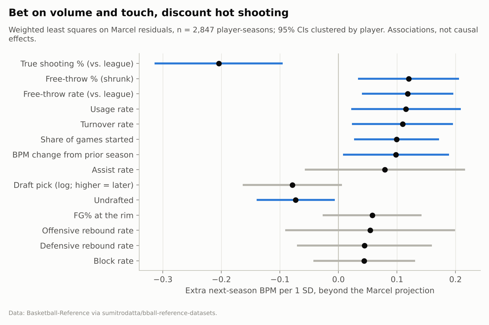

# Beyond the Box Score: Finding Hidden Value in Young NBA Players

**Most one-year "leaps" by young NBA players are regression to the mean. This project separates luck from real growth, and finds that the box score's development signal lives in offensive load and touch, not shooting efficiency.**

Using every player aged 24 or younger with 500+ minutes since 2000-01 (3,285 player-seasons), I forecast next-season Box Plus/Minus and test each season using only data available at the time. The bar to clear is **Marcel**, a disciplined projection that already accounts for age and regression to the mean.

| | |
|---|---|
| **Out-of-sample gain over Marcel** | **3.1%** lower error; 95% CI 0.021 to 0.086 BPM; better in 8 of 10 test seasons |
| **Top-decile predicted improvers** | gained 1.5+ BPM **62%** of the time (Marcel 50%, base rate 29%) |
| **Strongest growth signals** | usage, free-throw rate, free-throw %, turnover rate, games started (all +) and true shooting (−) |
| **Adds nothing measurable** | on/off plus-minus, team quality, draft slot, height, shot location; gradient boosting doesn't beat ridge |
| **80% prediction intervals** | 79.9% empirical coverage (but too narrow when a player's minutes collapse) |

📄 **[Read the research report](reports/report.md)** · [web version](reports/report.html) · 📓 [Research notebook](notebooks/research_notebook.ipynb) · 📊 Dashboard: `streamlit run app.py`



---

## Why a front office should care

Rookie-scale extensions, trades for young players, and minutes on rebuilding teams are all bets on development. The common mistake is to learn from last year's "most improved" players. Nine of the ten biggest BPM jumps in 2025-26 came from players who started at negative BPM, which is mostly bad seasons bouncing back. This project asks the harder question: **once you know age and track record, what else predicts growth?**

What a team could do differently:
- **Discount efficiency-driven breakouts.** A young player whose BPM rests on hot shooting at low usage is likelier to regress.
- **Treat free-throw rate and free-throw % as development signals.**
- **Don't over-penalize turnovers** in young players carrying a big offensive load.
- **Use the model-minus-Marcel gap as a scouting shortlist,** not a verdict. The 2026-27 forecast flags Stephon Castle, Keyonte George, Isaiah Collier and Alex Sarr as players the signals like more than a standard projection. It is more skeptical of Kon Knueppel's shooting-driven rookie season.

**Honest scope.** BPM is a box-score *estimate* of impact, not RAPM or tracking-based impact, and it under-rates defense the box score can't see. All findings are predictive associations, not causal effects. The edge is small; most year-to-year change is noise, role and health.

---

## Methodology in one screen

| Piece | Choice | Why |
|---|---|---|
| Data | Basketball-Reference season tables via a pinned public mirror ([details](data/README.md)) | Complete, versioned, reproducible; NBA Stats is not reliably reachable |
| Population | Age ≤ 24, ≥ 500 MP, base seasons 2000-01 to 2024-25; outcome needs ≥ 250 MP | Young players with enough minutes to measure |
| Outcome | Next-season BPM, errors weighted by next-season minutes | BPM over few minutes is noise |
| Features | 39 season-*t* features: track record, era-adjusted per-possession rates, empirical-Bayes-shrunk FT%/3P%, shot profile, on/off, draft slot, size, team SRS | All known at the time of the forecast |
| Baselines | Persistence, age curve, **Marcel** (5/4/3 minutes-weighted history, regressed with fitted *k*, plus aging) | A model has to beat a disciplined projection, not a strawman |
| Models | Ridge regression; histogram gradient boosting as a nonlinear check | Simplest credible model first |
| Validation | **Rolling origin**: each season 2016-17 to 2025-26 predicted by models refit on earlier seasons only; hyperparameters tuned on pre-2016 data | Mirrors real-time use; no leakage |
| Uncertainty | Player-clustered paired bootstrap; online conformal 80% intervals | Same player appears in several seasons |
| Interpretation | WLS of (actual − Marcel) on standardized features, player-clustered SEs; collinear pairs (r ≥ 0.75) removed | Readable effect sizes, in BPM per SD |
| Robustness | 8 sensitivity variants (age cutoffs, minute thresholds, COVID seasons, inverse-probability weighting for survivorship) | All keep the same conclusions and signs |

---

## Quick start

Requires Python 3.11+ (tested on 3.13).

```bash
git clone https://github.com/doxxk/nba-player-analytics.git
```

```bash
cd nba-player-analytics
```

```bash
python -m venv .venv && source .venv/bin/activate
```

```bash
pip install -r requirements.txt && pip install -e .
```

Run the full analysis. It downloads about 24 MB once into `data/raw/`, then takes about 2 minutes and rewrites `reports/tables/` and `reports/figures/`:

```bash
python -m bbs.pipeline
```

After that first run, a fast offline re-run on a 2012-2026 extract the pipeline saved locally (writes to `outputs/sample/`, leaves the published results untouched):

```bash
python -m bbs.pipeline --sample
```

Re-run from cached raw files without touching the network:

```bash
python -m bbs.pipeline --offline
```

Run the tests (the fast suite takes a few seconds; tests that use real data skip until the pipeline has run once):

```bash
pytest
```

Include the end-to-end sample pipeline test (about 45 seconds):

```bash
pytest -m slow
```

Launch the dashboard (every tab works from the committed result tables; the player-comparison view needs one pipeline run):

```bash
streamlit run app.py
```

Re-execute the notebook:

```bash
jupyter nbconvert --to notebook --execute --inplace notebooks/research_notebook.ipynb
```

---

## Repository layout

```
beyond-the-box-score/
├── app.py                     Streamlit dashboard (reads reports/tables + local data)
├── src/bbs/
│   ├── config.py              Data source pin, paths, study-design parameters
│   ├── data/
│   │   ├── acquire.py         Cached, checksummed downloads with retries
│   │   ├── schema.py          Required-column validation with clear errors
│   │   └── clean.py           One row per player-season; traded players; team context; draft
│   ├── features.py            TS%, empirical-Bayes shrinkage, era adjustment, lags, outcome
│   ├── analysis.py            Regression to the mean, age curve, attrition, signal regression
│   ├── models.py              Baselines, ridge/GBM, rolling origin, bootstrap, conformal, IPW
│   ├── viz.py                 Report figures (colorblind-safe palette)
│   └── pipeline.py            End-to-end CLI: python -m bbs.pipeline
├── tests/                     pytest: metrics, edge cases, leakage guards, sample, dashboard
├── notebooks/research_notebook.ipynb
├── reports/
│   ├── report.md              Research write-up
│   ├── figures/               8 figures used in the report
│   └── tables/                Every number in the report (CSV + results.json + provenance)
├── data/
│   ├── README.md              Sources, retrieval, limitations, licensing
│   ├── sample/                (git-ignored) local extract for offline re-runs
│   ├── raw/                   (git-ignored) downloaded CSVs + manifest
│   └── processed/             (git-ignored) parquet outputs
├── requirements.txt           Pinned versions
└── pyproject.toml             Package + pytest config
```

**Data flow:** `acquire` (download and cache) → `schema` (validate) → `clean` (player-seasons) → `features` (model table) → `analysis` + `models` (rolling-origin evaluation) → `viz` and CSV tables → `app.py` / `report.md`.

---

## Limitations

- **BPM is the target**, so the model inherits its blind spots, especially off-ball defense.
- **Survivorship:** 9% of player-seasons have no next season with 250+ MP, mostly players projected to decline. Inverse-probability weighting leaves results unchanged, but it can only correct for what is observed.
- **The largest misses** are role changes (trades, promotions) and injuries, which the box score can't see.
- **Intervals undercover** (69%) for players whose next-season minutes fall below 1,000.
- **No salary or contract data.** This says nothing about market value.
- **Data terms:** statistics come from Basketball-Reference (Sports Reference LLC). Code is MIT-licensed; the data is not. See [data/README.md](data/README.md).

## Acknowledgements

Basketball-Reference for the data; Sumitro Datta for the public CSV mirror; Daniel Myers for BPM; Tom Tango for the Marcel method.
