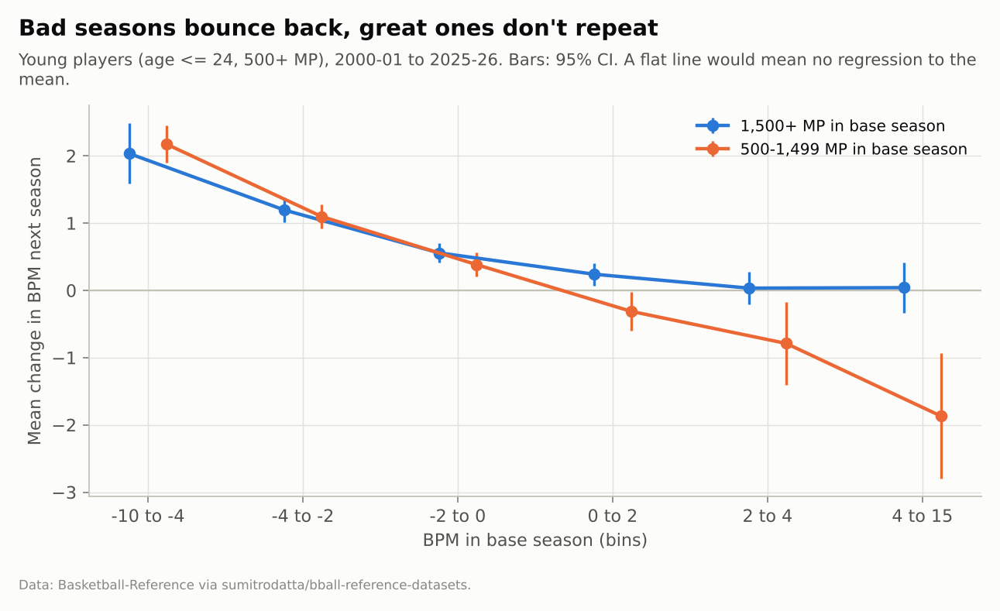
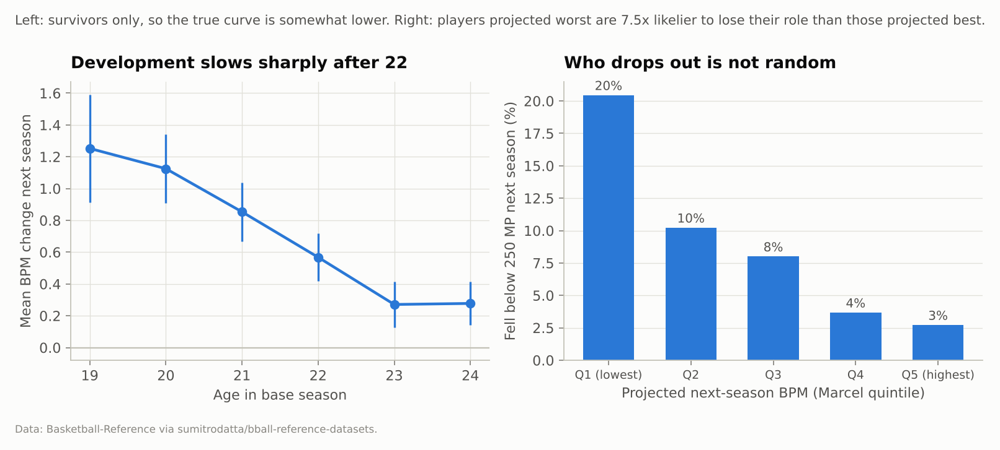
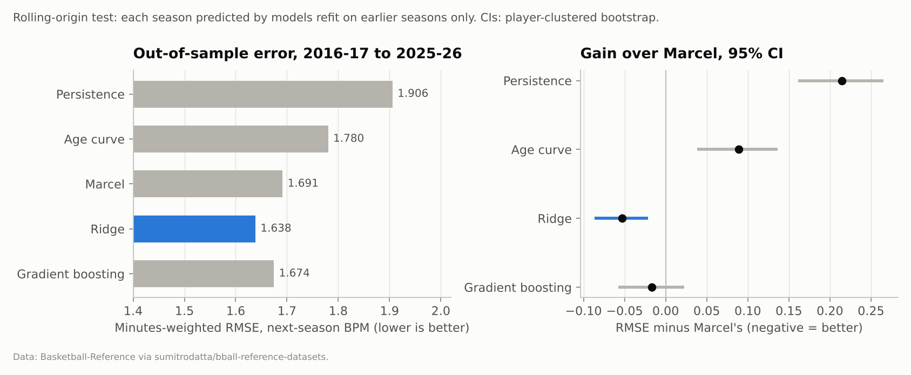
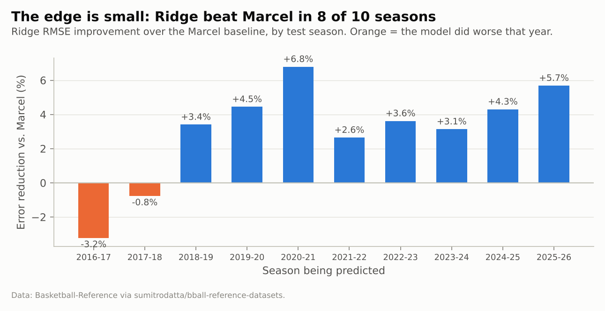
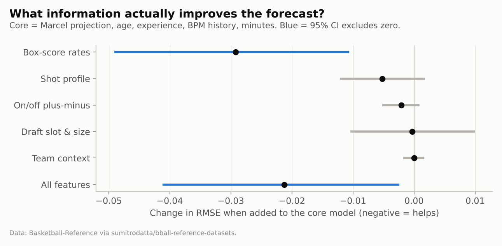
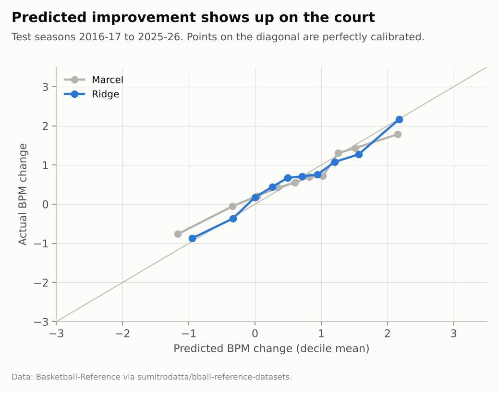
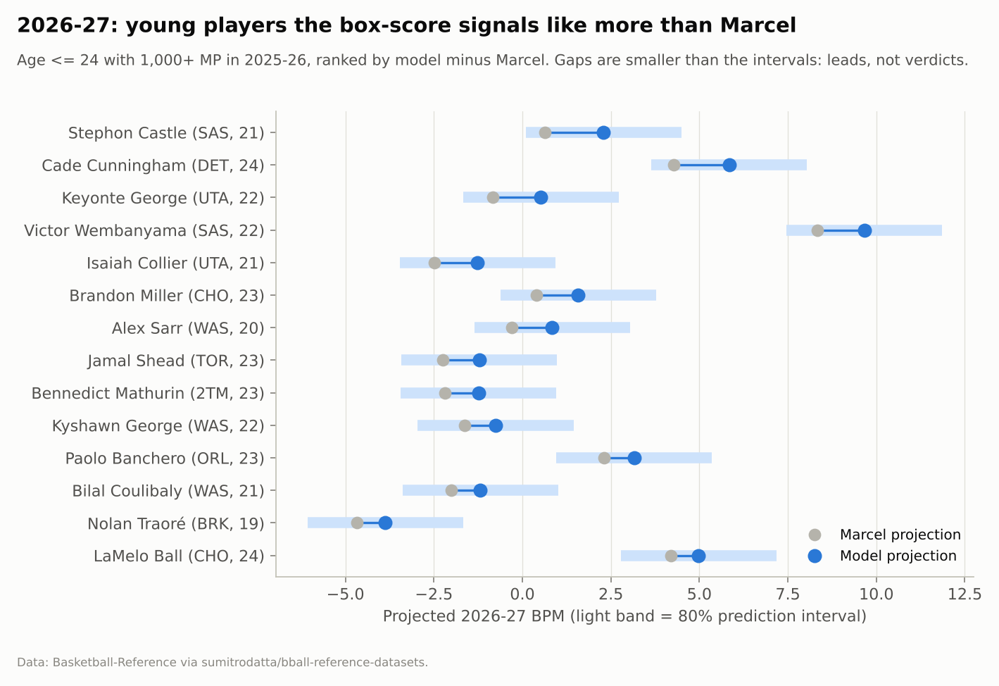

# Beyond the Box Score: Finding Hidden Value in Young NBA Players

**Takeaway:** Most one-year "leaps" by young NBA players are regression to the mean. The real growth signal in the box score is offensive load and touch (usage, free-throw rate, free-throw percentage), not shooting efficiency, and it beats a disciplined projection by a small margin that holds up statistically.

*Data through the 2025-26 season. Forecast for 2026-27 made before the season began. All numbers below are produced by `python -m bbs.pipeline`; nothing is hand-entered.*

---

## 1. Executive summary

Every year, front offices decide which young players to extend, trade for, or hand a bigger role. The core question is always the same: *is this player going to get better?*

I studied 3,285 seasons by players aged 24 or younger with at least 500 minutes, from 2000-01 through 2025-26. I forecast each player's next-season Box Plus/Minus (BPM), testing every season with only the information available at the time.

1. **Raw improvement mostly measures luck reversing.** Young players coming off a −4 BPM or worse season gained about **+2.0 BPM** the next year on average. Those at +4 or better gained essentially nothing. Nine of the ten biggest BPM jumps in 2025-26 started from a negative base season.
2. **A disciplined baseline is hard to beat.** A Marcel-style projection (weighted history, regressed to the mean, plus aging) cuts error by 11% versus "same as last year" (RMSE 1.69 vs. 1.91 BPM).
3. **Box-score rates add a small but real edge.** A ridge regression reduces Marcel's error by **3.1%** (95% CI: 0.021 to 0.086 BPM, player-clustered bootstrap). It won in 8 of 10 test seasons. Its top-decile predicted improvers gained 1.5+ BPM **62%** of the time, against 50% for Marcel and a 29% base rate.
4. **What carries the edge.** For the same projection, players with higher **usage, free-throw rate, free-throw percentage and turnover rate**, and those who **started more games**, grew more. Players whose BPM was propped up by **above-average true shooting** regressed more.
5. **What doesn't.** On/off plus-minus, team quality, draft slot, height and shot location add nothing measurable once the box score is known. Gradient boosting did not beat the linear model.

The effects are modest: 0.1 to 0.2 BPM per standard deviation. This is a tool for sharpening priors and prioritizing film study, not a replacement for scouting.

---

## 2. The basketball question

> **Which young players will improve next season, and which signals predict that improvement beyond what age and regression to the mean already explain?**

This matters because development is where value is created and destroyed:

- **Rookie-scale extensions** are decided after year three, on two or three seasons of noisy data.
- **Trades for young players** are bets on future growth, not current production.
- **Minutes and role allocation** on rebuilding teams is a development decision.

The trap is that the obvious approach ("who improved most last year, and what did they have in common?") rediscovers regression to the mean. So this project asks the harder question: *conditional on a sensible projection, what else predicts growth?*

**What this is not.** BPM is a box-score *estimate* of a player's contribution per 100 possessions ([Myers, BPM 2.0](https://www.basketball-reference.com/about/bpm2.html)). It is not on-court impact measured from lineups (RAPM) or tracking data, and it is known to under-rate defense that doesn't produce steals, blocks or rebounds. Everything here is predictive association, not cause and effect.

---

## 3. Data and sample

**Source.** Basketball-Reference season tables (advanced, totals, per-100 possessions, shot location, play-by-play, draft, team summaries), via the public [sumitrodatta/bball-reference-datasets](https://github.com/sumitrodatta/bball-reference-datasets) mirror. I pinned it to commit `76a70b4` (April 13, 2026), after the 2025-26 regular season ended; all 30 teams show 82 games. The pipeline downloads nine CSVs once and records a SHA-256 manifest. NBA Stats and Basketball-Reference were unreachable from the build environment, and I didn't try to get around their access controls. See [`data/README.md`](../data/README.md).

**Sample construction.**

| Step | Rule | Rows |
|---|---|---|
| NBA player-seasons 1996-97 to 2025-26 | drop ABA/BAA | 18,254 |
| Collapse traded players | keep Basketball-Reference's combined row | 14,569 |
| Young-player base seasons | age ≤ 24 (Feb 1), MP ≥ 500, season ≥ 2000-01 | 3,285 |
| Historical (outcome season exists) | base seasons through 2024-25 | 3,129 |
| Outcome observed | ≥ 250 MP the next season | 2,847 (91%) |

**Outcome.** Next-season BPM. Errors are weighted by next-season minutes (capped at 2,000), because BPM over 300 minutes is mostly noise.

**Features (39).** All are known at the end of season *t*:
- **Track record:** age, experience, BPM/OBPM/DBPM history, minutes, share of games started.
- **Per-possession rates:** usage, assist, turnover, rebound, steal and block rates. True shooting, 3PA rate and FT rate are expressed *relative to that season's league average*, so the three-point revolution doesn't masquerade as player development.
- **Shrunk shooting:** FT% and 3P% use empirical-Bayes shrinkage (beta-binomial priors estimated on pre-2016 seasons only). The priors work out to roughly 21 attempts for FT% and 193 for 3P%, so a 4-for-10 three-point shooter is treated as close to average.
- **Shot profile:** distance, rim attempts, FG% at the rim, % of 2s assisted, dunks.
- **On/off:** on-court and on/off net plus-minus per 100 possessions.
- **Pedigree:** draft slot (the later draft for players drafted twice, and never before it happened), undrafted flag, height, weight.
- **Team context:** minutes-weighted team SRS; traded mid-season.

---

## 4. Method

### Baselines

| Baseline | Prediction |
|---|---|
| **Persistence** | Next season = this season. |
| **Age curve** | This season + average one-year change at this age. |
| **Marcel** | Last three seasons weighted 5/4/3 by minutes, blended with *k* minutes of league-average prior, plus a fitted age adjustment. Adapted from Tom Tango's Marcel baseball projections. *k* is chosen on training data (it lands at 250 minutes). |

Marcel is the benchmark that matters. It already "knows" age and regression to the mean, so beating it means finding information it lacks.

### Models

- **Ridge regression** on all 39 features plus the Marcel projection, with median imputation and standardization.
- **Histogram gradient boosting** as a nonlinear check.

Hyperparameters were tuned **only on base seasons before 2016**: train on 2000-11, validate on 2012-15. The test period was never used for any modeling choice.

### Validation: rolling origin

For each base season *Y* from 2015-16 to 2024-25, every model is refit on all earlier seasons and predicts *Y + 1*. That gives 1,258 out-of-sample player-seasons across ten seasons, and it is exactly what a team could have done in real time. Uncertainty comes from a **player-clustered paired bootstrap**: players, not rows, are resampled because the same player appears in several test seasons.

### Prediction intervals

These are online split-conformal intervals. For test season *Y*, the 80% half-width is the 80th percentile of absolute out-of-sample errors from seasons before *Y*, so coverage is an honest forecast, not a fitted quantity.

### Interpretation model

To ask *which* signals matter, I regress (actual − Marcel projection) on standardized features with weighted least squares and player-clustered standard errors. One feature from each pair with |r| ≥ 0.75 is dropped so coefficients are readable. This is enforced by a test, not just a comment.

---

## 5. Findings

### 5.1 Most "improvement" is regression to the mean

Players coming off −4 BPM or worse gain about two points the next season, whether they played heavy or light minutes. At the top end, minutes matter. Players at +4 or better over 1,500+ minutes hold their level (+0.04, CI −0.33 to +0.42). Those who did it in fewer than 1,500 minutes give back almost two points (−1.87, CI −2.80 to −0.94).

**Why it matters.** A raw "most improved" list is mostly a list of players who had unlucky or miscast seasons. Of the ten biggest jumps from 2024-25 to 2025-26, nine started from negative BPM (average −2.3). Some, like Stephon Castle and Alex Sarr, are probably real growth. The list alone can't tell you which.

### 5.2 Development is front-loaded, and survivors flatter the curve

- **Age curve.** 19-20-year-olds gain about +1.2 BPM a year, falling to +0.6 at 22 and +0.3 at 23-24.
- **Attrition.** 9% of player-seasons have no usable next season, and the dropouts are not random. Players in Marcel's lowest projected quintile fall out of the rotation **20%** of the time, versus **3%** in the top quintile.
- **Consequence.** Any model trained on survivors sees an over-optimistic low end. I re-ran every conclusion with inverse-probability weighting (section 7).

### 5.3 A disciplined baseline does most of the work

| Model | Weighted RMSE | Rank corr. of predicted vs. actual change | Top-decile hit rate* |
|---|---|---|---|
| Persistence | 1.906 | n/a | n/a |
| Age curve | 1.780 | 0.16 | 36% |
| **Marcel** | **1.691** | **0.37** | **50%** |
| **Ridge** | **1.638** | **0.41** | **62%** |
| Gradient boosting | 1.674 | 0.40 | 52% |

\*Share of each model's top 10% predicted improvers who gained 1.5+ BPM. The base rate is 29%.

- **Ridge vs. Marcel:** −0.053 RMSE (95% CI −0.086 to −0.021).
- **Gradient boosting vs. Marcel:** −0.017 (CI −0.058 to +0.022). It is not distinguishable from Marcel, and it is worse than the simpler linear model. There is no evidence of nonlinearity worth paying for.

The edge is consistent rather than driven by one lucky season. Ridge beat Marcel in 8 of 10 test seasons, from +2.6% to +6.8% in 2018-19 through 2025-26. It lost narrowly in the first two seasons, when it had the least training data.

### 5.4 What information actually helps?

Adding one feature group at a time to a core model (track record + age + minutes + Marcel), with the same rolling-origin splits:

- **Core-only ridge** already beats Marcel (1.660 vs. 1.691). Part of the gain is simply better use of the same information, such as splitting BPM into its offensive and defensive halves and using games-started share.
- **Box-score rates** are the only group that clearly helps: −0.029 RMSE (CI −0.049 to −0.011).
- **Shot profile** (−0.005), **on/off plus-minus** (−0.002), **draft slot and size** (0.000) and **team context** (0.000) add nothing distinguishable from zero.

The "all features" model (−0.021) is slightly *worse* than core + box rates (−0.029), a sign that the extra groups add noise. I kept the all-features model as the main specification because it was chosen before seeing test results. Switching now would be selecting on the test set. A leaner model is a hypothesis to confirm on 2026-27 outcomes.

**Why on/off doesn't help.** For young players, a season of on/off is extremely noisy and largely reflects lineup context. Once usage, efficiency and rebounding are known, it carries no extra forecasting signal for BPM. That's a statement about *predicting box-score impact*, not a claim that on/off data is worthless for evaluating defense.

### 5.5 Bet on volume and touch, discount hot shooting

Effects are in extra next-season BPM per one standard deviation, holding the Marcel projection and all other features fixed (n = 2,847; 95% CIs clustered by player):

| Signal | Effect per SD | 95% CI | Basketball reading |
|---|---|---|---|
| True shooting % vs. league | **−0.21** | −0.31 to −0.10 | BPM built on hot shooting regresses; efficiency is the noisiest part of the box score |
| Free-throw % (shrunk) | **+0.12** | +0.03 to +0.21 | Touch is a skill indicator; long-run shooting growth shows up here first |
| Free-throw rate vs. league | **+0.12** | +0.04 to +0.20 | Getting to the line signals rim pressure and creation |
| Usage rate | **+0.12** | +0.02 to +0.21 | Players trusted with volume tend to grow into it |
| Turnover rate | **+0.11** | +0.02 to +0.20 | Given usage, turnovers mark ball-handling responsibility, not just carelessness |
| Share of games started | **+0.10** | +0.03 to +0.17 | The coaching staff's revealed belief carries information |
| BPM change from prior season | **+0.10** | +0.01 to +0.19 | A little momentum survives Marcel's regression |
| Undrafted | −0.07 | −0.14 to −0.01 | Slight extra fade for undrafted breakouts |

**What a front office could do with this:**
- **Discount efficiency-driven breakouts.** A young role player with a strong BPM built on +5% true shooting at low usage is likelier to regress than one with the same BPM built on creation.
- **Treat free-throw percentage as a development signal,** not just a free-throw signal.
- **Don't over-penalize turnovers** in young high-usage players.
- **Don't expect on/off, draft position or team quality to add information** beyond the box score in this kind of model.

The R² on Marcel residuals is 0.057, so these signals explain a small slice of what Marcel misses. Most year-to-year variation is noise, role and health.

### 5.6 Calibration

Binned by predicted change, ridge forecasts sit on the diagonal. Its top decile predicts +2.18 BPM and averages +2.17, and its bottom decile predicts −0.95 and averages −0.87. Marcel is too extreme at both ends: its top decile predicts +2.15 but averages +1.78, and its bottom decile predicts −1.16 but averages −0.76. In other words, the box-score signals mostly help sort *which* players Marcel is over- or under-rating, not shift everyone up or down.

---

## 6. 2026-27 forecast: where the model disagrees with Marcel

Ranking players by *projected change* just lists last season's worst low-minute seasons, which is regression to the mean again. The informative quantity is **model minus Marcel**: the part of the forecast driven by box-score signals.

**Among young players with 1,000+ minutes in 2025-26, the model likes these players more than Marcel:**

| Player | Team | Age | 2025-26 BPM | Marcel | Model | 80% interval |
|---|---|---|---|---|---|---|
| Stephon Castle | SAS | 21 | 1.9 | 0.6 | **2.3** | 0.1 to 4.5 |
| Cade Cunningham | DET | 24 | 6.3 | 4.3 | **5.9** | 3.7 to 8.0 |
| Keyonte George | UTA | 22 | 0.9 | −0.8 | **0.5** | −1.7 to 2.7 |
| Victor Wembanyama | SAS | 22 | 10.7 | 8.3 | **9.7** | 7.5 to 11.9 |
| Isaiah Collier | UTA | 21 | −2.4 | −2.5 | **−1.3** | −3.5 to 0.9 |
| Brandon Miller | CHO | 23 | 1.6 | 0.4 | **1.6** | −0.6 to 3.8 |
| Alex Sarr | WAS | 20 | 0.7 | −0.3 | **0.8** | −1.4 to 3.0 |

The common thread is load. Castle (25% usage, FT rate +0.21 over league) and George (28% usage, 88% shrunk FT%) carry big offensive roles at modest efficiency, exactly the profile the signal model favors.

**Counterexample: where the model is *more* skeptical.** Kon Knueppel (CHO, 20) posted +2.8 BPM as a rookie. Marcel, which only sees the BPM and his age, projects him to improve to +3.6. The model projects +2.8, flat: his season leaned on above-league true shooting (+5%) with a below-average free-throw rate and 22% usage. That is not a prediction that he is overrated. It says his profile looks like players whose shooting-driven seasons tend not to build further, and it is the first thing I would check on film.

These gaps (about 1 to 1.7 BPM) are smaller than the ±2.2 BPM intervals. They are **leads for scouting, not verdicts**. The forecast is falsifiable, and I will score it against 2026-27 results.

---

## 7. Robustness and limitations

### Sensitivity analysis

Each variant re-runs the full rolling-origin comparison and the signal regression:

| Variant | n test | Ridge − Marcel RMSE [95% CI] | TS% | FT% | FT rate | Usage |
|---|---|---|---|---|---|---|
| Main specification | 1,258 | −0.053 [−0.084, −0.022] | −0.21 | +0.12 | +0.12 | +0.12 |
| Age ≤ 22 | 679 | −0.090 [−0.142, −0.034] | −0.26 | +0.20 | +0.17 | +0.05 |
| Age ≤ 26 | 1,805 | −0.043 [−0.069, −0.021] | −0.20 | +0.13 | +0.07 | +0.08 |
| Base MP ≥ 1,000 | 948 | −0.065 [−0.102, −0.027] | −0.16 | +0.11 | +0.09 | +0.11 |
| Base MP ≥ 300 | 1,386 | −0.056 [−0.087, −0.026] | −0.26 | +0.12 | +0.13 | +0.10 |
| Next-season MP ≥ 500 | 1,158 | −0.054 [−0.088, −0.023] | −0.22 | +0.12 | +0.12 | +0.11 |
| Exclude 2019-20 & 2020-21 outcomes | 1,016 | −0.041 [−0.075, −0.004] | −0.21 | +0.12 | +0.12 | +0.09 |
| Inverse-probability weighting | 1,258 | −0.051 [−0.082, −0.019] | −0.21 | +0.12 | +0.12 | +0.12 |

The ridge edge holds in every variant and is **largest for the youngest players** (age ≤ 22: −0.090), where box-score signals have the most development left to predict. Every key coefficient keeps its sign in every variant. Survivorship weighting changes nothing material.

### Where the model fails

- **Role changes and injuries.**
  - The largest *positive* misses were breakouts tied to new roles: Victor Oladipo after his 2017 trade to Indiana, Giannis Antetokounmpo in 2016-17, Ja Morant in 2021-22, Dejounte Murray in 2021-22.
  - The largest *negative* misses were mostly injury-shortened seasons, such as Michael Porter Jr.'s 265 minutes in 2021-22.
  - The box score can't see a trade, a coaching change, or a back injury coming.
- **Intervals are miscalibrated by minutes.** Overall 80% coverage is 79.9%. It is only 69% for players who end up with 250-999 minutes, against 85% and 82% in the higher-minute bins. Uncertainty is larger than advertised exactly when a player's role collapses.
- **BPM's blind spots carry through.** If BPM undervalues a player's defense, so does this model.
- **No market context.** Nothing here speaks to salary or contract value.

### Leakage and bias checks

- **Temporal integrity:**
  - Every feature is known at the end of season *t*.
  - Shrinkage priors and hyperparameters come from pre-2016 data only.
  - Draft slot is hidden until the draft has happened.
  - A unit test verifies that changing season *t+1* data leaves season-*t* features unchanged, and another verifies that no model ever trains on its test season.
- **Survivorship:** handled by inverse-probability weighting (no material change), but it can only correct for selection on observed traits.
- **Multiple comparisons:** 23 coefficients are tested. The strongest (TS%, p < 0.001) survives any reasonable correction; the weaker ones (p ≈ 0.01-0.03) should be treated as suggestive.

---

## 8. Conclusion and future work

**Robust findings:**
- Raw improvement is dominated by regression to the mean.
- Young players develop fastest before 22.
- A modest set of box-score signals (offensive load up, shooting efficiency down) adds a small, consistent edge over a disciplined projection.

**Uncertain:**
- The exact magnitude of each signal.
- Whether a leaner model would do better.
- How the 2026-27 calls turn out.

**What would improve this most:**
1. **Better outcome measures:** multi-year RAPM or a luck-adjusted on/off as the target, so the model isn't just predicting a box-score formula.
2. **Tracking data** (drives, touches, defensive matchups) to measure skills the box score infers indirectly.
3. **Injury and role data** (games missed, coaching changes, depth chart) to address the largest misses.
4. **Minutes forecasting** as a second model. For a front office, "will he get better?" and "will he play?" are separate questions.
5. **Scoring the 2026-27 forecast** in April 2027 and reporting the result, good or bad.

---

### References

- Myers, D. *About Box Plus/Minus (BPM 2.0).* Basketball-Reference. <https://www.basketball-reference.com/about/bpm2.html>
- Tango, T. *Marcel the Monkey Forecasting System.* (Original description of the Marcel method, Tangotiger.net, 2004.)
- Efron, B. & Morris, C. (1975). Data analysis using Stein's estimator and its generalizations. *JASA*, 70(350), 311-319.
- Lei, J., G'Sell, M., Rinaldo, A., Tibshirani, R. & Wasserman, L. (2018). Distribution-free predictive inference for regression. *JASA*, 113(523), 1094-1111.
- Data: Basketball-Reference (Sports Reference LLC), via [sumitrodatta/bball-reference-datasets](https://github.com/sumitrodatta/bball-reference-datasets), commit `76a70b4`.
